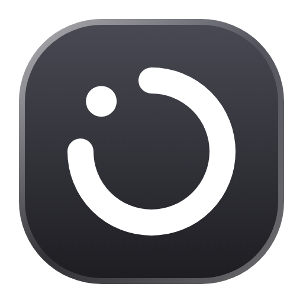
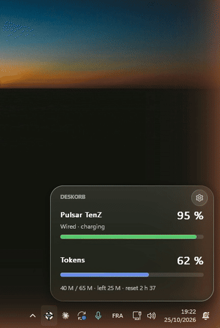
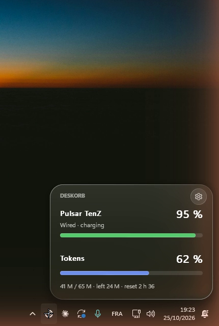
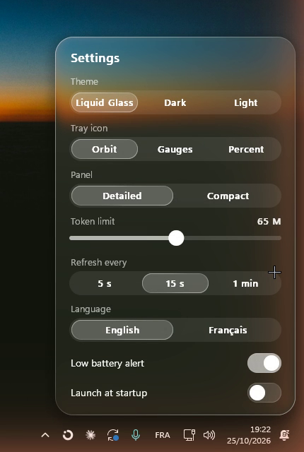
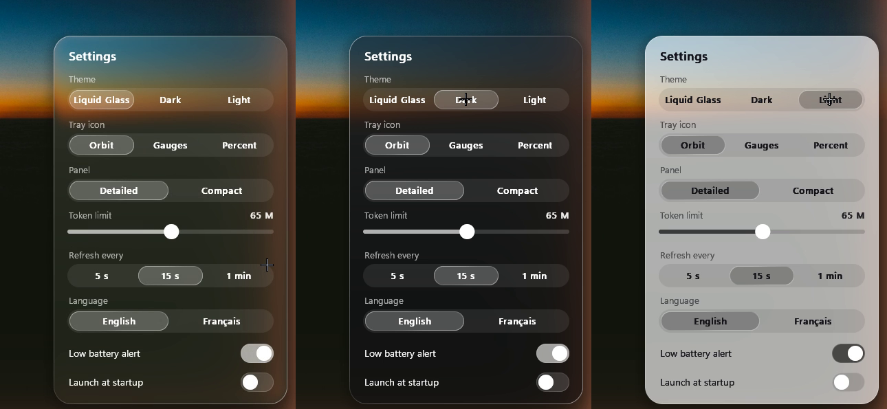
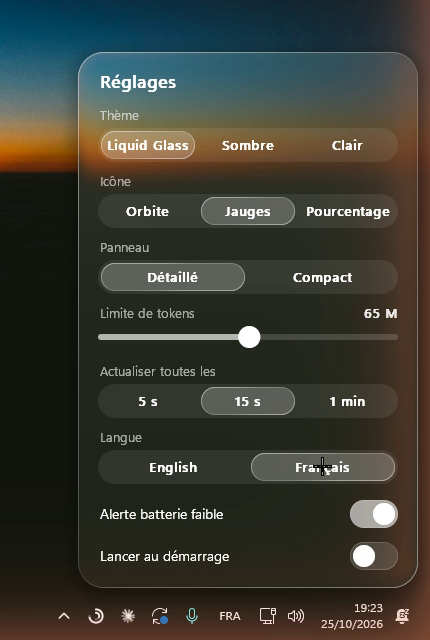
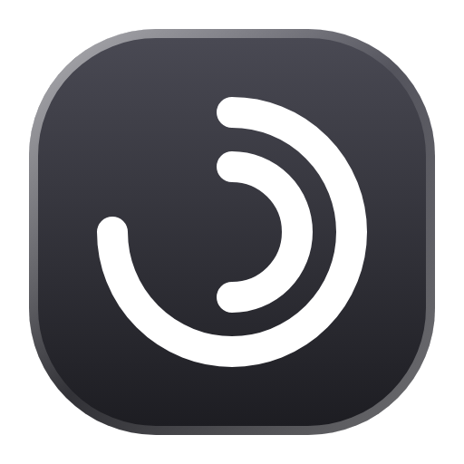

<div align="center">



# Deskorb

**Your wireless mouse battery and your live Claude usage limits, right in the taskbar.**

A tiny Windows tray app with a Liquid Glass panel: see how much charge your Pulsar mouse has left and where you stand on your Claude session and weekly limits, without opening anything.




▶ [Watch the 24 s demo video](docs/media/deskorb.mp4)

</div>

---

## What it does

<table>
<tr>
<td width="50%"></td>
<td width="50%"></td>
</tr>
<tr>
<td><b>One click away.</b> Click the tray icon: a glass panel rises above the taskbar with your mouse battery, whether it's wired, wireless, charging or asleep, and your Claude limits: the 5-hour session and the weekly one, each with its reset time.</td>
<td><b>Make it yours.</b> Theme, tray icon, panel density, refresh rate, language, low-battery alert and launch at startup, all live, all animated.</td>
</tr>
<tr>
<td></td>
<td></td>
</tr>
<tr>
<td><b>Three themes.</b> Liquid Glass (the background refracts through the panel), Dark and Light.</td>
<td><b>English or French.</b> Follows your Windows language on first launch, switch anytime.</td>
</tr>
</table>

### A tray icon that is a widget

Pin the icon next to the clock (drag it out of the hidden icons) and you can read your status without clicking. Pick its style in the settings:

|  |  | **42** |
| :---: | :---: | :---: |
| **Orbit**: one ring that fills with your battery (or your Claude session when no mouse is found) | **Gauges**: outer ring = battery, inner ring = Claude session | **Percent**: just the number |

## Supported hardware and data

- **Mice**: Pulsar wireless mice on the 8K "dx" dongle (`3710:5406`, e.g. X2 CrazyLight / TenZ Edition), wired or wireless. Other dongles speaking the same protocol (Kysona, ATK, VXE family) may work but are untested.
- **Claude usage**: the same session and weekly percentages as Claude's own *Usage limits* screen, fetched live from Anthropic with Claude Code's sign-in (`~/.claude/.credentials.json`). Sign in once with `claude auth login`; Deskorb renews the token like Claude Code does. Anthropic rate-limits this request, so it's refreshed every 2 minutes (and when you open the panel), backing off on its own if asked to.

## Use

| Action | Effect |
| --- | --- |
| Click the tray icon | opens the panel |
| Click the gear in the panel | opens the settings |
| Right-click the tray icon | Settings, Quit |
| Click elsewhere or press Esc | closes |

### Settings

- **Theme**: Liquid Glass, Dark, Light
- **Tray icon**: Orbit, Gauges, Percent
- **Panel**: Detailed or Compact
- **Refresh every**: 5 s, 15 s, 1 min (mouse; Claude usage every 2 min)
- **Language**: English, Français
- **Low battery alert**: a Windows notification under 20 %
- **Launch at startup**

Saved in `%APPDATA%\Deskorb\settings.txt`.

## Under the hood

- **Native Rust**, a single dependency (`windows-sys`), a ~500 KB executable.
- **Liquid glass engine from [DESKTOUCH](https://github.com/DanyalRez/DESK-TOUCH)**: the background is captured and blurred, a lens refracts the edges, colours split slightly in the corners, a light rim follows the shape. Spring animations paced to your screen's refresh rate; **nothing runs at rest**.
- **Mouse battery over HID, no driver**: 17-byte vendor reports on the dongle's `FF02` collection, the same protocol as the Linux kernel's `hid-pulsar` driver. When the mouse sleeps it stops answering, so Deskorb keeps the last value and says *asleep*.
- **Claude usage over WinHTTP** (built into Windows), on a background thread so the UI never stalls. The token is only read from Claude Code's file and only sent to Anthropic.
- **Light on memory**: the glass images are freed as soon as a window closes and idle pages are handed back to Windows, so Deskorb sits around 1 MB of working set at rest.

## Build from source

```bash
cargo build --release
```

```bash
target/release/deskorb.exe
```

Needs Rust with the `x86_64-pc-windows-gnu` target and MinGW (`windres` embeds the icons).

Two diagnostic flags print to the console:

```bash
cargo run -- --probe
```

```bash
cargo run -- --tokens
```

`--probe` lists HID interfaces and reads the mouse battery; `--tokens` prints your live Claude session and weekly usage.

## Credits

- Battery protocol: the Linux [`hid-pulsar`](https://github.com/torvalds/linux/blob/master/drivers/hid/hid-pulsar.c) driver; device IDs cross-checked with [pulsar-mouse-linux](https://github.com/packerlschupfer/pulsar-mouse-linux).
- Glass recipe adapted from [AndroidLiquidGlass](https://github.com/Kyant0/AndroidLiquidGlass) (Kyant, Apache-2.0), via DESKTOUCH.
- Logos: `assets/orbite/` and `assets/jauges/` (SVG sources, PNG, `.ico` from 16 to 256 px).

Not affiliated with Pulsar Gaming Gears or Anthropic.
